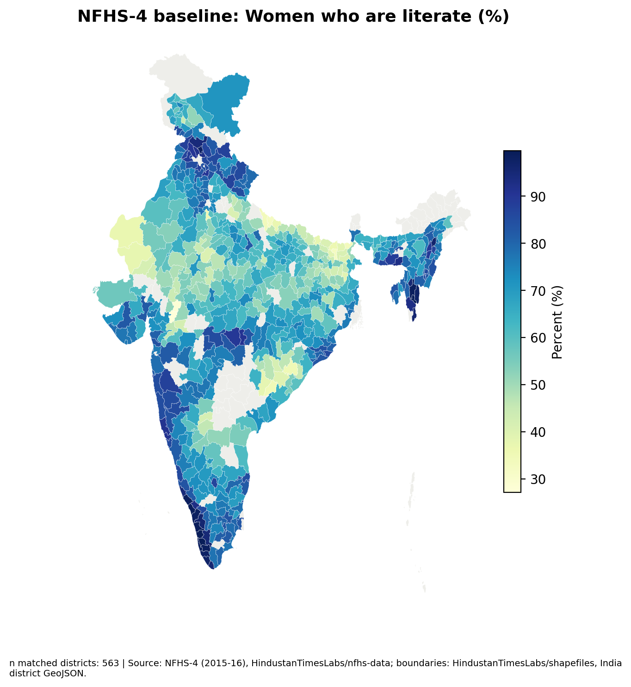
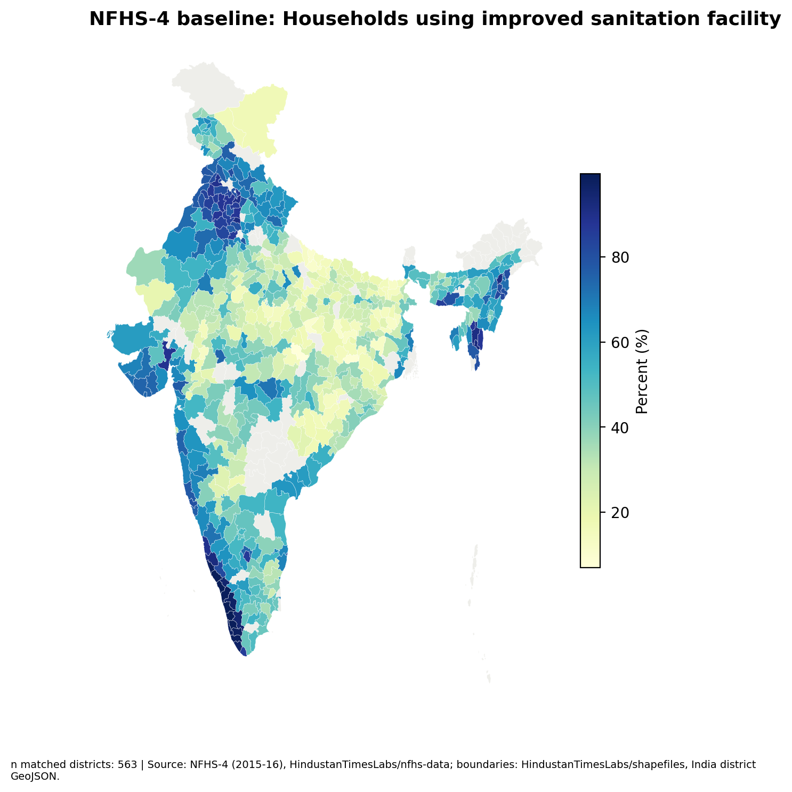

# ZilaLens
## Women's Financial Inclusion and Empowerment Across Indian Districts, NFHS-4 (2015-16) to NFHS-5 (2019-21)

**Author:** Kanishk Gupta  
**About the Author:** Kanishk Gupta, PGDM (Research & Business Analytics), Lal Bahadur Shastri Institute of Management, Delhi — [GitHub](https://github.com/GKanishk16)

"Zila" is Hindi for district; ZilaLens views women's financial inclusion through a district lens.

ZilaLens is a reproducible research project designed to compare women's financial inclusion and related empowerment indicators across Indian districts. All findings are intended to come from public source files and are subject to survey and boundary limitations.

## Current data status

NFHS-4 district factsheet compilation is present in `data/raw/nfhs_district-wise.csv`. The official NFHS-5 workbook listed in the data.gov.in catalog could not be downloaded in this environment (HTTP 403). Two-round results and all cross-round deliverables are therefore pending; no changes, rankings, clusters, or impact estimates are claimed. Download the catalog resource **“India Districts Factsheets of National Family Health Survey (NFHS) - 5, 2019-2021”** (Excel workbook, approximately 740 KB) and save it exactly as `data/raw/NFHS_5_India_Districts_Factsheet_Data.xls`, then rerun the pipeline. Source record: [`docs/DATA_SOURCES.md`](docs/DATA_SOURCES.md).

## Key Findings

No cross-round findings are published yet because NFHS-5 could not be acquired. The NFHS-4 input currently contains 59,241 district-indicator rows, 10 source columns, and 93 district-level indicators across the source file; these are source-file counts, not substantive findings. See [`data_quality_report.md`](data_quality_report.md) for availability and missingness diagnostics after running the pipeline.

## Setup and run

Python 3.11 is the target runtime.

```bash
python -m venv .venv
source .venv/bin/activate
pip install -r requirements.txt
python run_all.py
```

## Repository guide

- `src/`: ingestion, harmonisation, and analysis code
- `data/raw/`: source files (large/raw files are not committed; download scripts and URLs are documented)
- `data/processed/`: tidy panel, crosswalk, and reviewed name overrides
- `docs/`: source register and qualitative codebook
- `outputs/`: tables, charts, maps, workbook, reports, and deck
- `tests/`: pipeline tests

Raw files over 50 MB must not be committed. Keep them reproducible through source links/download scripts. Never commit API keys or tokens. Data belongs to IIPS/MoHFW NFHS, data.gov.in, and NITI Aayog; the MIT licence covers code only.

## Preview maps

NFHS-4 baseline maps are included as interim previews; NFHS-5 levels and round-to-round change maps are pending the official workbook.





## Deliverables

- [Research report](outputs/reports/ZilaLens_Research_Report.docx) — pending two-round dataset
- [Policy brief](outputs/reports/ZilaLens_Policy_Brief.docx) — pending two-round dataset
- [Concept note](outputs/reports/ZilaLens_Concept_Note.docx) — pending data-backed district selection
- [Deck](outputs/deck/ZilaLens_Deck.pptx) — pending computed results

## Citation

See [`docs/DATA_SOURCES.md`](docs/DATA_SOURCES.md). Every statistic in the final deliverables will cite its source table and be traceable to a file in `data/`.
